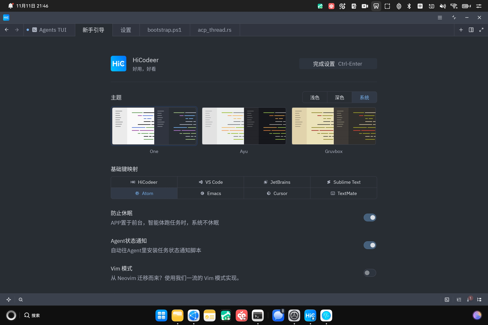
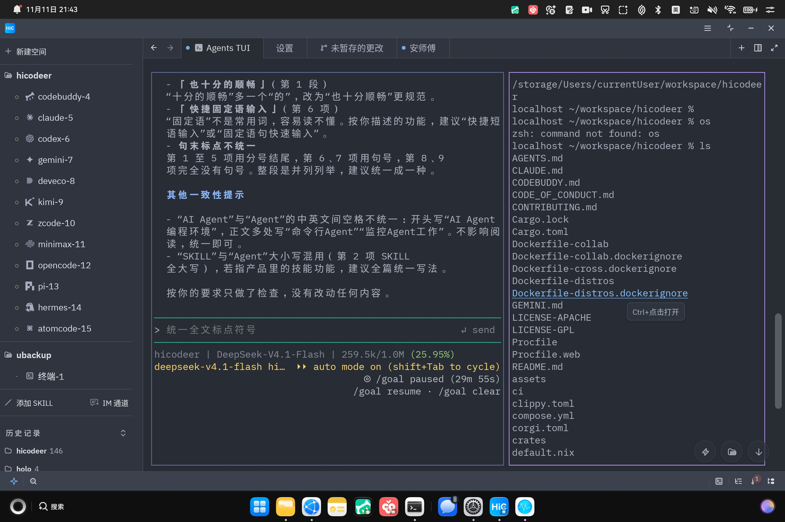
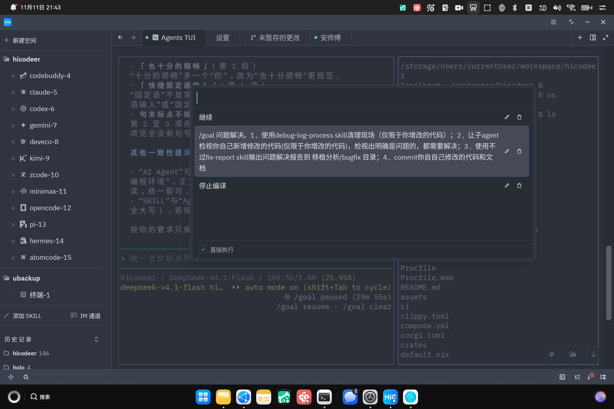
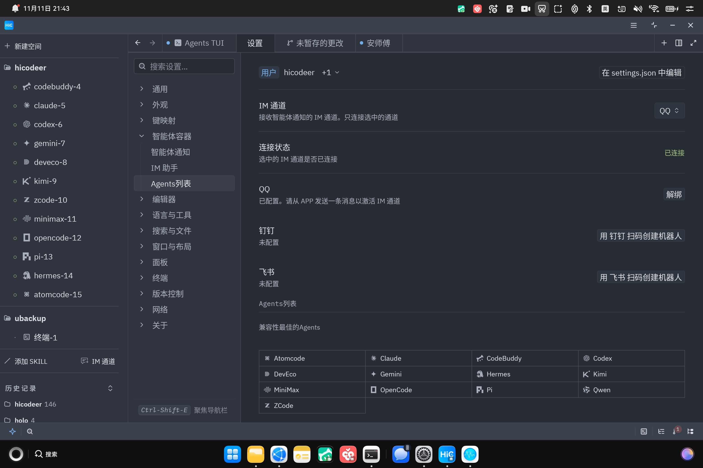
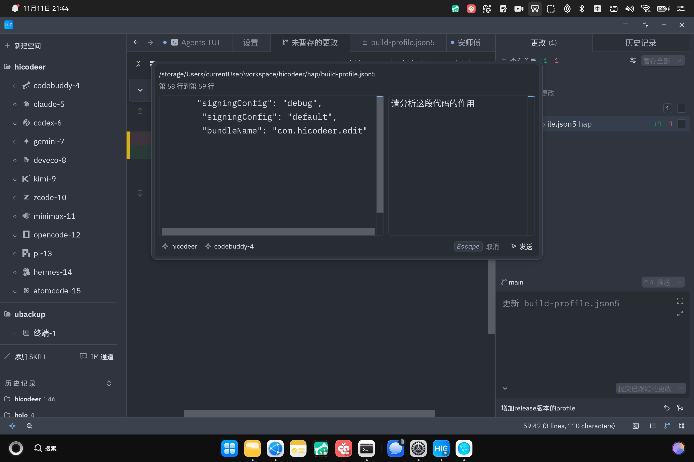
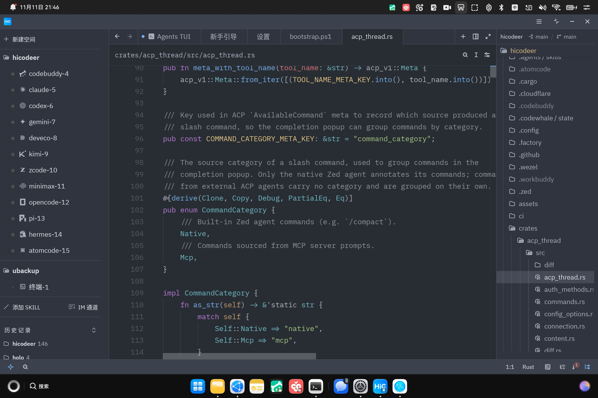
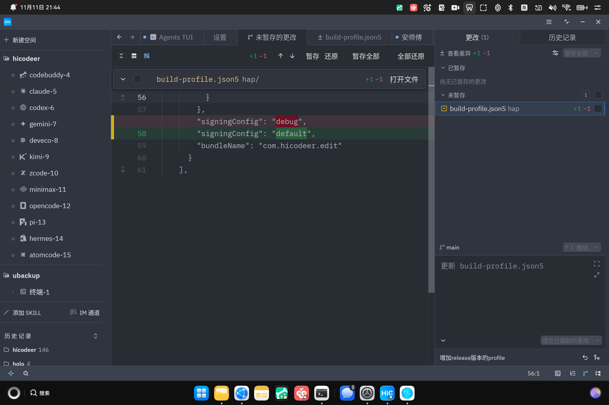

# 项目介绍
HiCodeer 是面向鸿蒙平台的命令行 Agent 编程环境，既有体验极佳的命令行Agent管理能力，也有比肩通用代码编辑器的代码读写体验。使用Rust语言，运行速度超快，打开大型代码工程也十分顺畅。把AI 编程、代码阅读、版本管理集成在一个软件内，是十分得力的AI编程工具。支持主流的十几款命令行Agent。

1. 提供多Agent管理能力。命令行 Agent 在同一窗口内运行、可随时切换；
2. 提供不同厂商Agent相互通信的能力和SKILL，让不同Agent也可以协同完成工作；
3. 程序退出不影响后台Agent运行，即使Agent退出，重新打开程序也能自动拉起Agent；
4. Agent 工作完成/阻塞有声音和视觉提醒，监控Agent工作很简单；出门在外也可以将工作状态推送到QQ、钉钉、飞书，以及将这些IM的指令转给Agent执行；
5. Agent 工作时防止熄屏，长时间不卡壳；工作完成自动熄屏，更省电；
6. 提供了自定义的固定语句快速输入、框选内容发给Agent、终端内打开文件/URL链接等功能，极大简化了与Agent交互的步骤；
7. 提供Git操作窗口，不离开APP也可以完成版本管理；
8. 提供比肩代码编辑器的代码读写能力，比如支持LSP等功能；
9. 也是一个非常好用的通用文本编辑工具，支持右键打开方式、文件拖入。

# 界面预览

以下界面截图直观展示了 HiCodeer 的核心功能。

## 新手引导与个性化设置

首次启动提供新手引导，可选择主题（One / Ayu / Gruvbox，浅色 / 深色 / 系统）、基础键映射（HiCodeer / VS Code / JetBrains / Sublime Text / Atom / Emacs / Cursor / TextMate），并可开关防止休眠、Agent 状态通知与 Vim 模式。

## 多 Agent 同窗口管理与集成终端

左侧列出十几种命令行 Agent，在同一窗口内运行、可随时切换；中间是与 Agent 的对话会话，右侧是集成终端，无需离开软件即可查看目录与运行命令。

## 快捷固定语句快速输入

弹出面板集中展示"继续""停止编译"等自定义固定语句，可勾选直接执行，把常用指令一键发给 Agent，极大简化交互步骤。

## Agent 状态推送与 IM 通道

在设置中配置 QQ、钉钉、飞书等 IM 通道，把 Agent 的完成 / 阻塞状态推送到手机，并将 IM 指令转给 Agent 执行；下方列出兼容性最佳的 Agent。

## 框选内容发给 Agent

在编辑器中框选代码片段，输入"请分析这段代码的作用"等说明即可发给指定 Agent，同时支持在多个 Agent 之间选择接收方。

## 比肩代码编辑器的代码读写

提供语法高亮、行号与项目文件树等代码读写能力，并支持 LSP，阅读和编辑大型工程同样顺畅。

## 不离开 APP 的 Git 版本管理

内置 Git 操作窗口，可查看代码差异、暂存 / 还原更改、查看历史记录并提交，全程无需离开软件。

# Licensing
本项目基于Zed、Herdr开发，同时使用了GPUI的鸿蒙适配代码Openharmony-ability、gpui-ohos开源代码，以及这些软件依赖的其他开源代码。License遵照上游这些代码的License。新增代码使用Apache-2.0协议。
